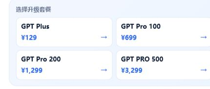

# UPGPT ChatGPT 套餐价格与开票说明：Plus 129元/月起

想了解 ChatGPT 相关服务的人民币报价，并提前安排付款、查单或开票？可以先从 [UPGPT 官网](https://upgpt.pro/?utm_source=github_pages&utm_medium=article&utm_campaign=organic_20261109_existing_member_price&utm_content=current-price-invoice) 查看当前商品。本页集中说明四档月价，以及订单查询和发票申请需要保留的信息。

UPGPT 运营发布｜商业推广，AI辅助整理｜2026年11月9日复核。UPGPT 是独立第三方服务，与 OpenAI 无隶属关系。

## 四档套餐，当前参考月价

| UPGPT 商品名称 | 人民币参考价格 |
| --- | --- |
| GPT Plus | ¥129 / 月 |
| GPT Pro 100 | ¥699 / 月 |
| GPT Pro 200 | ¥1,299 / 月 |
| GPT PRO 500 | ¥3,299 / 月 |

以上采用 UPGPT 当天公开商品名称，不代表 OpenAI 官方套餐名称。具体权益、可用状态和实付金额，以 [购买页](https://upgpt.pro/purchase?utm_source=github_pages&utm_medium=article&utm_campaign=organic_20261109_existing_member_price&utm_content=current-price-invoice) 当时展示为准。

*2026年11月9日 UPGPT 首页快捷选套餐区域实拍；图中展示四档商品与当前参考金额，月度周期按官网套餐详情区另行复核。*

## 已有会员与下单联系方式：两项常见问题

### 已有会员下单是否另收费？

当前购买页明示，Free 和会员账户购买同一套餐的价格相同。同价不等于会员周期叠加；本服务可能覆盖当前套餐和剩余周期，检测到会员后仍须确认覆盖。

### 下单联系方式必须是 GPT 绑定信息吗？

不需要。当前购买页允许填写微信、手机号或其他联系方式，并说明不要求是 GPT 绑定信息。请保留下单时填写的原联系方式，用于查单和必要联络。独立查单密码不是 GPT 账号密码，也不替代实际履约要求的完整 Session JSON。

## 支付宝、微信付款；查单密码独立设置

当前购买页提供支付宝和微信支付。下单时填写的联系方式需要保留原内容，之后查询订单时会用到。

购买页要求设置8–64位独立查单密码，用于查询订单和申请发票。它不是 ChatGPT 登录密码，不要与 ChatGPT 密码混用。

需要查询时，从 [订单查询与发票申请入口](https://upgpt.pro/order/search?utm_source=github_pages&utm_medium=article&utm_campaign=organic_20261109_existing_member_price&utm_content=current-price-invoice) 使用原下单联系方式和查单密码。未设置查单密码的旧订单，可通过原订单详情链接查看；链接遗失时，按网站提示联系客服核验。

## 有开票需求，提前准备哪些资料？

网站提供发票申请入口。商家 [隐私政策](https://upgpt.pro/privacy?utm_source=github_pages&utm_medium=article&utm_campaign=organic_20261109_existing_member_price&utm_content=current-price-invoice) 写明，开票申请会收集以下资料，用于人工审核、开票与投递：

- 单位名称
- 单位税号
- 收票邮箱

开票金额按本笔订单获取。若用于单位报销，建议先核对所需抬头和收票邮箱，再按具体订单提供的功能申请。

各档订单的开票适用条件、发票类型、税率及办理时间，请以商家确认和订单页面为准；本次未核验实际发票表单或完成开票。

## 购买前了解实际服务条件

UPGPT 采用覆盖式充值，可能覆盖当前套餐和剩余会员周期。已有会员时，应先确认是否接受这一规则。

当前实际履约仍要求提供完整 ChatGPT Session JSON，其中可能包含可访问账号的登录令牌。独立查单密码没有替代这一要求；不接受该账户授权条件时，请勿购买。本文不提供会话或令牌的获取、复制或提交步骤。

套餐与履约条件可查看 [UPGPT 服务条款](https://upgpt.pro/terms?utm_source=github_pages&utm_medium=article&utm_campaign=organic_20261109_existing_member_price&utm_content=current-price-invoice)；处理结果以订单状态和原账号实际套餐为准，不承诺固定到账时间。

## 查看当前报价

[打开 UPGPT 购买页，查看套餐与当次金额](https://upgpt.pro/purchase?utm_source=github_pages&utm_medium=article&utm_campaign=organic_20261109_existing_member_price&utm_content=current-price-invoice)。有开票需求时，可在付款前通过官网客服确认具体订单是否适用。

[历史文章目录](https://hookunlou-create.github.io/chatgpt-pro-plus-upgrade-guide/guides.html) 保留供查阅，其中部分页面为旧版本；价格、名称和当前服务条件以本页及商家最新页面为准。

